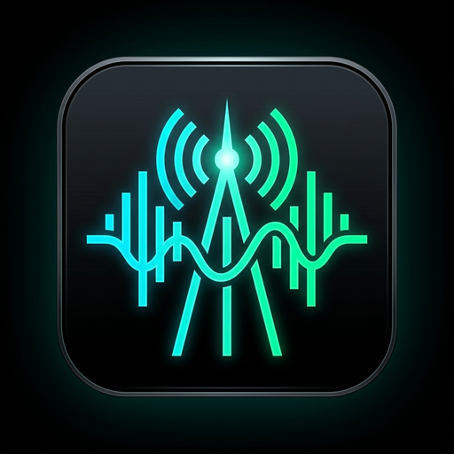
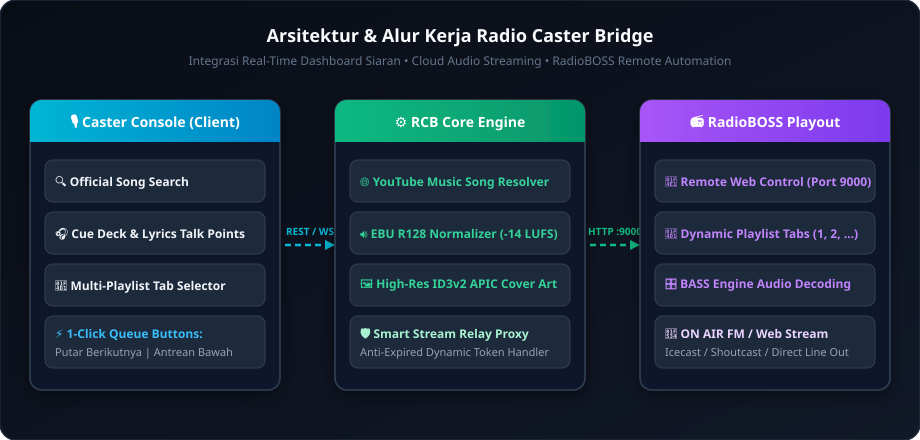
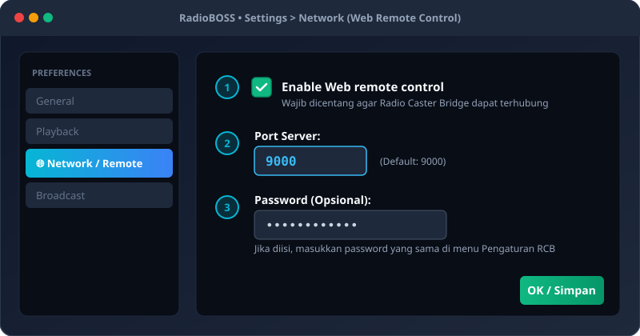
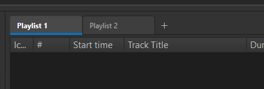

<div align="center">

  

  # Radio Caster Request Bridge (RCB) 🎙️📻
  
  **Modern Broadcast Console & YouTube Music Gateway for RadioBOSS Automation Engine**

  <p align="center">
    <i>Kirim lagu resmi YouTube Music langsung ke antrean RadioBOSS secara live stream tanpa membebani harddisk, terintegrasi lirik, preview headphone, normalisasi audio EBU R128, dan multi-playlist switcher.</i>
  </p>

  <!-- Badges & Stats -->
  <p align="center">
    <a href="https://github.com/Tayen15/RadioBOSS-Controller/releases/latest">
      
    </a>
    <a href="https://github.com/Tayen15/RadioBOSS-Controller/releases">
      
    </a>
    <a href="https://github.com/Tayen15/RadioBOSS-Controller/releases/latest">
      
    </a>
    <a href="https://github.com/Tayen15/RadioBOSS-Controller/stargazers">
      
    </a>
    <a href="https://github.com/Tayen15/RadioBOSS-Controller/blob/main/LICENSE">
      
    </a>
  </p>

  <p align="center">
    
    
    
    
    
  </p>

  <p align="center">
    <a href="https://github.com/Tayen15/RadioBOSS-Controller/releases/latest"><b>[ ⬇️ Unduh Installer Windows (.exe) ]</b></a> •
    <a href="https://github.com/Tayen15/RadioBOSS-Controller/releases/latest"><b>[ 📦 Unduh Versi Portable (.zip) ]</b></a> •
    <a href="#-panduan-konfigurasi-radioboss-langkah-demi-langkah"><b>[ 📖 Panduan Setup ]</b></a>
  </p>

</div>

---

## 📐 Arsitektur & Alur Kerja Sistem

Radio Caster Request Bridge menghubungkan konsol siaran web/desktop modern dengan RadioBOSS Automation Playout Engine melalui protokol Web Remote Control API:

<p align="center">
  
</p>

---

## ✨ Fitur Unggulan

### 1. 🎵 Khusus Lagu Studio Master (Official Audio Only)
- Menggunakan integrasi YouTube Music Song Search dengan filter resmi (`filter="songs"` / *Auto-generated by YouTube*).
- **Zero Distraction:** 100% bebas dari intro video klip, suara dialog film/MV, outro sponsor, atau gangguan non-musik.
- Menghasilkan cover album rasio kotak 1:1 resolusi tinggi serta metadata artis & judul yang akurat.

### 2. 🛡️ Anti-Expired Smart Stream Relay (`/api/stream/{video_id}`)
- URL streaming CDN YouTube pada umumnya kadaluarsa setelah 4–6 jam.
- Fitur **Smart Stream Relay** bertindak sebagai reverse-proxy dinamis: selalu me-resolve token streaming baru secara instan saat RadioBOSS mulai memutar track tersebut. Lagu di antrean bawah tetap dapat diputar berjam-jam kemudian tanpa kendala error URL kadaluarsa.

### 3. 📑 Multi-Playlist Tab Management (RadioBOSS Tab Switcher)
- RadioBOSS mendukung banyak tab playlist (`Playlist 1`, `Playlist 2`, dll.).
- Broadcaster kini dapat **memilih tab tujuan** langsung dari dashboard Radio Caster Bridge tanpa perlu membuka jendela RadioBOSS.
- Menyediakan tab switcher 1-klik yang tersinkronisasi langsung dengan status playlist aktif di RadioBOSS.

### 4. 🧠 Playback-Aware Smart Queue Positioning
- **Saat RadioBOSS Sedang ON AIR / Playing:** Tombol *"Putar Berikutnya"* otomatis menggunakan `pos=-2` (masuk tepat setelah lagu yang sedang berputar).
- **Saat RadioBOSS Sedang STOP / Idle:** Tombol *"Putar Berikutnya"* otomatis menggunakan `pos=1` (masuk di urutan teratas playlist sehingga langsung diputar saat Play ditekan).
- **Antrean Bawah (`pos=-1`):** Menempatkan lagu di antrean paling akhir.

### 5. 🔊 Normalisasi Audio EBU R128 (-14 LUFS) & Cover Art Bawaan
- Audio di-transcode secara background ke MP3 320 kbps dengan loudness standar penyiaran **EBU R128 (-14 LUFS, Target True Peak -1.5 dB)**.
- Menyematkan metadata ID3v2 APIC dan menyimpan file sidecar `<nama_lagu>.jpg` sehingga RadioBOSS menampilkan **Album Art, Artis, Judul, Tahun Rilis, dan Genre** secara native di layar siaran.

### 6. 🎧 Studio Cue Deck & Announcer Talking Points
- **Audio Preview di Headphone:** Dengarkan cuplikan lagu langsung dari dashboard sebelum mengirimkannya on-air.
- **Lirik & Panduan Penyiar:** Menampilkan lirik lagu lengkap dengan estimasi timing intro & outro untuk memandu *talking points* penyiar saat opening/closing lagu.

---

## ⚙️ Panduan Konfigurasi RadioBOSS (Langkah demi Langkah)

Sebelum menghubungkan Radio Caster Bridge, aktifkan fitur **Web Remote Control** di RadioBOSS:

<p align="center">
  
</p>

### 3 Langkah Cepat:
1. Buka aplikasi **RadioBOSS**, klik menu **Settings** / **Options** (atau tekan `Ctrl + P`), lalu pilih tab **Network**.
2. Beri centang pada opsi **"Enable Web remote control"**.
3. Atur **Port** (default: `9000`). *(Opsional)* Isi **Password** jika ingin mengamankan akses remote.
4. Klik **OK / Simpan**. RadioBOSS kini siap menerima perintah dari Radio Caster Bridge!

---

## 📑 Memilih Tab Playlist RadioBOSS

Jika stasiun radio Anda memiliki beberapa playlist aktif (misal: *Playlist Utama*, *Playlist Request*, *Top Chart*):

<p align="center">
  
</p>

1. Buka menu **Pengaturan (⚙️)** di Radio Caster Bridge $\rightarrow$ tab **Koneksi RadioBOSS**.
2. Masukkan nama tab yang ingin dituju (contoh: `Playlist 1` atau `Playlist 2`).
3. Pada tab **Antrean RadioBOSS**, Anda juga dapat mengklik langsung tab playlist untuk berpindah tab secara live saat siaran berlangsung.

---

## 🚀 Cara Instalasi & Menjalankan

### Opsi 1: Setup Wizard Installer (.exe) — *Direkomendasikan*
Cocok untuk penggunaan sehari-hari di PC studio siaran:
1. Unduh **`RadioBOSSCaster-Setup-x64.exe`** (atau versi `x86` untuk Windows 32-bit) dari halaman [Releases](https://github.com/Tayen15/RadioBOSS-Controller/releases/latest).
2. Jalankan file setup. Aplikasi terinstal rapi di `C:\Program Files\Radio Caster Bridge` lengkap dengan shortcut Desktop dan Start Menu.
3. Buka aplikasi, lalu buka menu **Pengaturan (⚙️)** untuk memasukkan IP/Port dan Password RadioBOSS Anda.

---

### Opsi 2: Portable Edition (.zip) — *Tanpa Perlu Instalasi*
Cocok untuk dijalankan dari USB Flash Drive atau tanpa hak akses Administrator:
1. Unduh **`RadioBOSSCaster-Portable-Windows-x64.zip`**.
2. Ekstrak folder ke direktori mana saja.
3. Jalankan `RadioBOSSCaster.exe`. Seluruh data, cache MP3, dan konfigurasi tersimpan lokal di dalam folder portable.

---

### Opsi 3: Linux OS (Ubuntu / Debian / Raspberry Pi)
1. Unduh paket `RadioBOSSCaster-Linux-x64` atau `RadioBOSSCaster-Portable-Linux-x64.tar.gz`.
2. Jalankan perintah:
   ```bash
   chmod +x RadioBOSSCaster-Linux-x64 run.sh
   ./run.sh
   ```

---

### Opsi 4: Mode Pengembang (Development Mode)

#### 1. Jalankan Frontend (Next.js dengan Bun):
```bash
cd frontend
bun install
bun run dev
```

#### 2. Jalankan Backend (FastAPI):
```bash
cd backend
python -m venv .venv
.venv\Scripts\activate   # Windows (atau 'source .venv/bin/activate' di Linux)
pip install -r requirements.txt
uvicorn app.main:app --host 0.0.0.0 --port 8000 --reload
```

---

## 📦 Perbandingan Pilihan Distribusi

| Fitur / Parameter | Setup Wizard (`*-Setup-*.exe`) | Portable Edition (`*-Portable-*.zip`) |
| :--- | :--- | :--- |
| **Lokasi Instalasi** | `C:\Program Files\Radio Caster Bridge\` | Folder bebas / Flashdisk USB |
| **Penyimpanan Konfigurasi** | `%APPDATA%\RadioBOSSCaster\` | Sub-folder `./data/` lokal |
| **Shortcut Desktop & Start Menu** | ✅ Dibuat Otomatis | ❌ Manual |
| **Uninstaller Standar Windows** | ✅ Terdaftar di Control Panel | ❌ Cukup hapus folder |
| **Hak Akses Admin** | Diperlukan saat setup awal | **100% Bebas Admin** |

---

## 🛠️ Tech Stack & Pustaka

- **Engine Backend:** Python 3.11+, FastAPI, Uvicorn, HTTPX (Keep-Alive Connection Pool), Pydantic Settings.
- **Audio Processing:** yt-dlp, ytmusicapi, FFmpeg (EBU R128 Loudness Filter), Mutagen (ID3v2 APIC).
- **Engine Frontend:** Next.js (App Router), TypeScript (Strict Mode), Tailwind CSS, DaisyUI, Lucide React.
- **Desktop Runtime:** pywebview (Microsoft Edge Chromium WebView2 & WebKit2GTK).
- **Packaging:** PyInstaller, Inno Setup Compiler.

---

## 📄 Lisensi

Proyek ini dirilis di bawah lisensi [MIT License](LICENSE). Bebas digunakan dan dimodifikasi untuk stasiun radio komersial, komunitas, maupun penggunaan pribadi.
